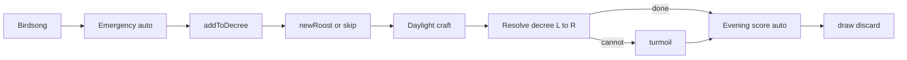

### Goal
- Ship **GP2**: playable `['marquise','eyrie']` game (Builder only).
- Law: `resources/rules/Law_of_Root.md` §7; summary: `resources/notes/root-base-rules.md` §Eyrie; roadmap: `resources/notes/grand-plan-toward-base-game.md` Phase 10.
- Gate: `auto --turns 50` default ends clean; temporary `--factions marquise,marquise` regression until final cleanup commit.

### Approach
- New `lib/src/factions/Eyrie.ts`; register in `factions/index.ts` (stop stubbing `MARQUISE` for `eyrie`).
- **Builder only** (house rule, already in base-rules): Charismatic/Commander/Despot deferred. Turmoil still runs Humiliate → Purge → Depose(retuck viziers Recruit+Move; leader stays `builder`) → Rest.
- **Loyal Viziers**: synthetic bird cards `{ id: 'vizier-0'|'vizier-1', defId: 'VIZIER' }` on decree; not in shared deck; `isVizier()` helper; count as birds for Humiliate; survive Purge.
- **Steps**: birdsong `emergency` → `decreeAdd` → `newRoost`; daylight `craft` → `decree`; evening `score` → `draw` → `discard`. Emergency + roost score = `autoActions` (like Marquise wood/draw).
- **Actions** (add to `actions/types.ts`):
  - `addToDecree`: `{ cards: [{ cardId, column }] }` length 1–2, ≤1 bird
  - `decree`: `{ column, cardId, ... }` — recruit `{ clearing }` / move `{ moves }` / battle `{ clearing, defender }` / build `{ clearing }`
  - `newRoost`: `{ clearing }` when zero roosts on map
  - `turmoil`: only legal when remaining decree card(s) have no full resolution
- **Cursor**: `turnScratch.decree: { column: DecreeColumn; remaining: string[] }` (card ids left in current column); advance column left→right after column empty.
- **Disdain**: extend `craftVp` in `triggers/hooks.ts` / `buildHooks.ts` — Eyrie item craft → 1 VP unless `leader === 'builder'` (printed); Master Engravers still stacks after.
- **Roost removal**: `rules/remove.ts` return roost → `roostTrack.placed++` (rightmost empty).
- **Already done** (do not redo): `EyrieBoard`, empty `createBoard('eyrie')`, roost craft sources, Lords of Forest in `ruler()` + test.
- Flip `DEFAULT_FACTIONS` → `['marquise','eyrie']` only after Eyrie turn loop works.
- CLI: teach `commands/auto.ts` decree builders + pass `--factions` into create.
- **Final cleanup**: retire GP1 `marquise,marquise` play mode — drop 2-cat keep/garrison specials, point fixtures/docs at `marquise,eyrie`, keep single-Marquise setup = `FALL.corners[0]` only.

#### Abilities — Law 7.2 (clarified)

**7.2.2 Lords of the Forest** — **already implemented**, no new commit.
- Where: `lib/src/queries/ruler.ts` + `isEyrieSeat`; test in `ruler.test.ts`.
- Behavior: strength = warriors + buildings only (`ruleWeight`; tokens 0). On **tie for max strength**, if an Eyrie seat is among the tied seats → that Eyrie rules (lowest seat if ever two). Else tie → no ruler.
- Matches Law: tied for most warriors+buildings **and** ≥1 Eyrie piece (piece that contributes strength is enough; empty Eyrie with only non-rule pieces cannot be in the tie set).

**7.2.3 Disdain for Trade** — **not implemented yet** → commit 12.
- Where: base `craftVp` in `defaultRuleHooks` / `buildHooks` (before `craft.item` signal).
- Behavior: when crafter is Eyrie **and** card is an **item** **and** `leader !== 'builder'` → score **1** instead of printed `CardDef.vp`. Non-item crafts unchanged.
- **Builder (7.8.1)**: ignore Disdain → use printed VP (GP2 always Builder, so Disdain path is latent until other leaders).
- Extra VP (Master Engravers): still via `craft.item` signal **after** `craftVp` (+1), not via replacing `craftVp` — Law “still score extra crafting points”.

### Files to change
- `lib/src/factions/Eyrie.ts` (+ `Eyrie.test.ts`): setup, steps, legal/validate/apply, autoActions
- `lib/src/factions/index.ts`: register `EYRIE`
- `lib/src/actions/types.ts`: Eyrie actions
- `lib/src/state/types.ts`: `turnScratch.decree`
- `lib/src/state/boards.ts`: roost track VP/draw constants (mirror Marquise track tables)
- `lib/src/state/constants.ts`: `DEFAULT_FACTIONS` (late commit)
- `lib/src/triggers/hooks.ts` + `buildHooks.ts`: Disdain `craftVp`
- `lib/src/rules/remove.ts`: roost → track
- `lib/src/format/prettyState.ts`: describe new actions + eyrie board dump
- `lib/src/factions/eyrie/viziers.ts`: vizier card helpers
- `frontend/cli/src/commands/auto.ts` (+ `index.ts` if `--factions` on auto)
- `resources/notes/root-base-rules.md`: confirm Builder-only turmoil depose house rule
- `PLAN.md`: this commit plan (execution tracker)

### Test plan
- Unit (fixtures): setup roost+6 at `opposite(corners[0])`, viziers Recruit+Move, roostTrack 6; Emergency Orders; addToDecree constraints; New Roost fewest-warriors; craft via roost; Builder printed VP vs Disdain path; decree recruit/move/battle/build happy+impossible→turmoil; Humiliate/Purge/Rest; evening roost VP + draw bonuses; roost return to track; Lords of Forest (existing).
- Intentional CLI scenarios (QA skill): decree bird overload → turmoil; build only ruled suit clearings; evening VP for 1..7 roosts.
- Gate: `auto --turns 50`; short-lived regression `marquise,marquise` until cleanup commit.
- After cleanup: no 2-cat keep/garrison paths; fixtures default `marquise,eyrie`; docs/README no longer advertise dual-cat.

### Commit plan
1. `docs: eyrie GP2 plan in PLAN.md`
   - `PLAN.md`
2. `feat(lib): eyrie roost track constants`
   - `lib/src/state/boards.ts` — `EYRIE_ROOST_VP`, draw-bonus indices
3. `feat(lib): eyrie vizier card helpers`
   - `lib/src/factions/eyrie/viziers.ts` (+ test)
4. `feat(lib): add eyrie decree actions + turnScratch`
   - `lib/src/actions/types.ts`, `lib/src/state/types.ts`, `lib/src/game/Game.ts` scratch init
5. `feat(lib): eyrie setup roost and warriors`
   - `lib/src/factions/Eyrie.ts`, `index.ts`, test — Rule 7.3.1–2,5
6. `feat(lib): eyrie setup Builder viziers`
   - `Eyrie.ts`, test — Rule 7.3.3–4 / 7.8.1
7. `feat(lib): return roosts to track on remove`
   - `lib/src/rules/remove.ts`, test
8. `feat(lib): eyrie birdsong Emergency Orders`
   - `Eyrie.ts`, test — Rule 7.4.1
9. `feat(lib): eyrie addToDecree action`
   - `Eyrie.ts`, test — Rule 7.4.2
10. `feat(lib): eyrie A New Roost`
    - `Eyrie.ts`, test — Rule 7.4.3
11. `feat(lib): eyrie daylight craft via roosts`
    - `Eyrie.ts`, test — Rule 7.5.1 (reuse `craftCard`)
12. `feat(lib): Disdain craftVp for eyrie`
    - `lib/src/triggers/hooks.ts` (or `buildHooks` base path): Eyrie + item + non-Builder → 1 VP
    - craft test: Disdain path (force non-builder board in fixture) + Builder keeps printed + Master Engravers +1 after
    - Rule: 7.2.3 + 7.8.1
13. `feat(lib): eyrie decree cursor + resolve loop`
    - `Eyrie.ts` — Rule 7.5.2 column L→R
14. `feat(lib): eyrie decree recruit`
    - `Eyrie.ts`, test
15. `feat(lib): eyrie decree move`
    - `Eyrie.ts`, test
16. `feat(lib): eyrie decree battle`
    - `Eyrie.ts`, test
17. `feat(lib): eyrie decree build`
    - `Eyrie.ts`, test
18. `feat(lib): eyrie turmoil`
    - `Eyrie.ts`, test — Rule 7.7 (Builder depose = retuck only)
19. `feat(lib): eyrie evening roost VP and draw`
    - `Eyrie.ts`, test — Rule 7.6
20. `dx(lib): pretty-print eyrie actions and board`
    - `lib/src/format/prettyState.ts`, test
21. `feat(lib): DEFAULT_FACTIONS marquise,eyrie`
    - `lib/src/state/constants.ts`, lobby/setup test — 2p still strips dominance
22. `feat(cli): auto plays eyrie decree`
    - `frontend/cli/src/commands/auto.ts` (+ `--factions` on auto if missing)
23. `docs(rules): note Builder-only turmoil depose`
    - `resources/notes/root-base-rules.md` Implementation deviations
24. `ci: eyrie GP2 gate`
    - fix any failing tests / smoke notes in README if needed
25. `chore(lib): retire marquise,marquise GP1 mode`
    - `lib/src/factions/Marquise.ts` — drop 2-cat `keepCornerFor` / garrison opposite specials; one Marquise → `FALL.corners[0]` only
    - `lib/src/factions/Marquise.test.ts`, `lib/src/game/Game.test.ts` — remove dual-cat setup cases
    - `lib/src/test/fixtures.ts` — default factions/players → `marquise,eyrie`
    - `lib/src/factions/index.ts`, `lib/src/state/constants.ts` comments — drop GP1 dual-cat wording
    - `resources/notes/root-base-rules.md`, `README.md` — remove 2-cat house rule / examples
